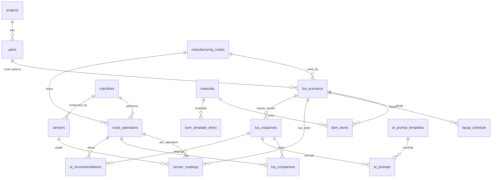

# Database design — built around the team's dashboard

The tables follow `manufacturing_lca_comparison_html_example.html`: every input box, table, KPI and button on that page has a home in the database. (An earlier version followed the handover note's draft schema; the dashboard's own table list in its section 10 is now the starting point, with the supporting tables it needs added.)

## Section by section

| Dashboard section | What it shows / does | Database |
|---|---|---|
| **2. Project and part** | Project, part number, description, functional unit, length / width / thickness, electricity factor; KPIs plan area, volume, BOM mass, selected route | `projects`, `parts`, `lca_scenarios.electricity_factor`; area and volume are calculated in `v_scenario_summary` |
| **3. BOM and layup** | Material drop-down, stage, mass used, waste %; table with consumed kg, kg CO₂e, MJ | `materials` (list + factors), `bom_items`, view `v_bom_calc`; layup in `layup_schedule` |
| 3. **Add BOM item** | Adds a line, recalculates | `add_bom_item(scenario, material_code, stage, mass, waste)` |
| 3. **Load example BOM** | Replaces the BOM with 7 standard lines | `load_bom_template(scenario, 'EXAMPLE_COMPOSITE')` ← `bom_template_items` |
| 3. **Remove** | Deletes a BOM line | `delete from bom_items …` |
| **4. Route comparison** | Route drop-down; expected scrap %; quantity; live variance alert %; table of operations (hours, kW, util., expected kWh, process kg CO₂e/kg, design kg CO₂e) | `manufacturing_routes`, `route_operations` (+ `machines`), `lca_scenarios` (route, scrap, quantity, alert %), view `v_route_op_calc` |
| 4. Choosing a route | A part gets a scenario for a route | `new_scenario(part, route_code, name, bom_template)` |
| **5. Stage 1 design baseline** | BOM / manufacturing / assembly + finishing / total design LCA | view `v_scenario_summary` (`bom_kgco2e`, `manufacturing_kgco2e`, `assembly_finishing_kgco2e`, `design_total_kgco2e`) |
| **6. Live production energy** | Operation, sensor / meter ID, actual kWh, machine state | `sensors`, `sensor_readings` |
| 6. **Add live reading** | Stores a reading (registers a new meter ID) | `add_live_reading(scenario, operation, sensor_code, kwh, state)` |
| 6. **Load example live data** | Fixed meter values for vacuum infusion; design kWh + 15 % for other routes | `load_example_live_data(scenario)` |
| 6. **Remove** | Deletes a reading | `delete from sensor_readings …` |
| **7. Design vs live comparison** | Per operation: design / live kWh, variance, variance %, status (OK / Watch / High / no live data), kg CO₂e; KPIs design total, live total, variance, extra kWh | live view `v_route_op_calc` + `v_scenario_summary`; saved copy in `lca_snapshots` + `lca_comparison` via `save_comparison(scenario)` |
| **8. AI improvement prompt** — *Generate prompt* | Builds the prompt: role, task, JSON context (project, part, route, totals, per-operation comparison), 9 questions, constraints | wording in `ai_prompt_templates`; `generate_ai_prompt(snapshot)` builds the context and text and stores it in `ai_prompts` |
| **9. Recommendations** — *Generate recommendations* | Lists operations above the alert % (largest excess first) or "no major variance", then 6 suggested actions | `generate_recommendations(snapshot)` writes `ai_recommendations` from the comparison and the `recommendation_actions` list; each row has owner, saving estimate, validation status |
| 8 + 9 together | | `run_analysis(scenario)` = save comparison + prompt + recommendations |

The dashboard in `docs/` reads the `v_dash_*` views and `v_scenario_summary`; the prompt wording and suggested actions it shows come from the database tables above.

## Tables (18)

`projects` · `parts` · `materials` · `lca_scenarios` · `manufacturing_routes` · `route_operations` · `machines` · `bom_items` · `bom_template_items` · `layup_schedule` · `sensors` · `sensor_readings` · `lca_snapshots` · `lca_comparison` · `ai_prompt_templates` · `ai_prompts` · `recommendation_actions` · `ai_recommendations`

The mock-up's own list (its section 10) is: projects, parts, lca_scenarios, bom_items, layup_schedule, manufacturing_routes, route_operations, sensor_readings, lca_comparison, ai_recommendations — all present. The other eight support the dropdowns and buttons (materials, machines, sensors, example BOM, saved snapshots, prompt wording, prompt history, standard actions).

## Design decisions
- **Scenario = part + route.** The BOM, layup and live readings belong to the scenario, so the same part can be compared across routes without overwriting anything. Route operations are shared templates; a reading must belong to an operation of the scenario's own route (enforced).
- **Calculated values are never typed in.** `consumed_kg` and `expected_kwh` are generated columns; kg CO₂e, MJ, variance and status come from views, so they cannot disagree with the inputs. Saved snapshots freeze a copy for the AI prompt and for reports.
- **Only approved materials count.** An unapproved material is left out of the totals and listed in `v_missing_factors`.
- **Prompt wording is data** (`ai_prompt_templates`) — edit it in the table editor, no code change.
- **AI never calculates.** Recommendations from rules are labelled `source = rule`/`library`; text from an AI tool would be added with `source = ai` and starts as `validation_status = proposed`, with `requires_engineering_validation = true` unless cleared.
- **Security.** Row-level security on every table; the public (anonymous) role has no access unless the optional file 4 is run, which exposes read-only dashboard views only.

## Not in the dashboard, so not (yet) in the database
Organisations, multiple impact categories, factor validity dates/versions, units table, production batches with quantities and scrap, oven loads (components per cycle), temperature/pressure readings, user roles and an audit log. The Word document's step-by-step process needs several of these (see `CALCULATION_PLAN.md` section 6); they can be added as new tables without changing the ones above.
